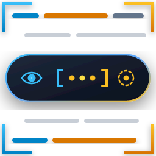

# Python Log Focus (VS Code Extension)

<p align="center">
  
</p>

<p align="center">
  <a href="https://github.com/zwgshr/python-log-focus/actions/workflows/ci.yml"></a>
  <a href="https://marketplace.visualstudio.com/items?itemName=zwgshr.python-log-focus"></a>
  <a href="https://github.com/zwgshr/python-log-focus/blob/main/LICENSE"></a>
</p>

一款专为 Python 开发者打造的 VS Code 扩展。智能识别代码中的 `logger.info(...)`、`logging`、`loguru`、`self.logger`、`structlog` 等日志调用，提供**视觉淡化 (Dim)**、**内联遮罩 (Mask)** 与**跨行折叠 (Fold)** 功能，消除日志视觉噪音，让你专注于核心业务逻辑。

---

## 🌟 核心特性

### 1. 视觉淡化 (Visual Dimming)
* **半透明灰化**：将所有日志语句的对比度降低（默认不透明度 35%，可自定义），让主干业务代码脱颖而出。
* **结构不破坏**：不改变代码缩进、行号和光标位置，阅读自然连贯。
* **自适应主题**：基于不透明度渲染，在浅色与深色主题下均完美呈现。

### 2. 内联遮罩 (Inline Masking)
* **紧凑占位符**：将长达多行的日志收起为如 `[ℹ️ Order processed...]` 或 `logger.info(…)` 的内联徽章。多行日志折叠后直观显示日志内容预览，不再仅仅显示三个点 `...`。
* **融合视觉淡化**：遮罩模式下自动采用低对比度幽灵文字（Ghost Text）与半透明淡化，视觉极度淡雅低调。
* **零空行优雅体验**：彻底解决跨行日志隐藏导致的空白行问题，多行日志智能首行遮罩与淡化，绝不产生破坏版面的多余空行。
* **极简组件化定制**：
  * **图标策略 (`maskIcon`)**：内置彩色 Emoji（`emoji`，默认）、极简几何符（`geometric`）、素雅工具（`subtle`）、终端代码字符（`ascii`）、无图标（`none`）或自定义字符（`custom`）。
  * **消除冗余 (`maskShowLevel`)**：默认关闭级别文字重复（呈现为 `[🐛 Order validation passed]` 而非 `[🐛 debug: ...]`）。
  * **方括号控制 (`maskShowBracket`)**：随时一键开启或关闭外层 `[]`。
  * **胶囊底色 (`maskShowBackground`)**：默认纯净无底色，亦可开启微透气泡。
* **跨行代码自动折叠 (`multilineFolding`)**：进入 Mask 模式时自动为跨多行日志执行折叠，退出时自动展开。

### 3. 光标焦点智能唤醒 (Smart Reveal on Cursor)
* 当光标移动到某条日志所在行进行编辑或查看时，该行日志**立即恢复 100% 完整高亮原代码**。
* 光标移开后，自动无缝恢复淡化或遮罩。

### 4. 极致精准与现代生态兼容
* **零依赖原生扫描器**：无需庞大的 Tree-sitter 原生二进制或 wasm，轻量极速。
* **现代 Python 3.14+ 深度适配**：原生支持 Python 3.14 (PEP 750) 模板字符串 `t"..."`、`tr"..."`，兼容 PEP 701 自由嵌套 f-string。
* **Loguru 全生态支持**：全面覆盖 Loguru 独有的 `success`、`trace` 核心级别，并原生支持 `.bind(...)`、`.opt(...)` 链式修饰调用。
* **支持复杂语法**：正确解析多行括号、字典嵌套、行内注释及字符串转义。
* **绝不误伤**：自动跳过字符串字面量（普通字符串、f-string、t-string）和注释中的 fake logger。

---

## 🚀 快捷操作

| 动作 | 快捷键 / 入口 | 说明 |
| :--- | :--- | :--- |
| **轮换模式** | `Alt + L` (Mac: `⌥L`) | 在 `淡化 (Dim) -> 遮罩 (Mask) -> 关闭 (Off)` 间快速循环 |
| **切换模式** | 点击右下角状态栏 `$(eye) Log: Dim` | 弹出模式选择面板 (QuickPick) |
| **命令面板** | `Cmd/Ctrl + Shift + P` | 搜索 `Python Log` 执行对应命令 |
| **折叠所有多行日志** | `Python Log: Fold All Multiline Logs` | 一键折叠当前文件所有跨行日志 |
| **展开所有多行日志** | `Python Log: Unfold All Multiline Logs` | 一键展开当前文件所有跨行日志 |

---

## ⚙️ 精简配置项 (Settings)

在 VS Code 的 `settings.json` 中可进行深度定制（已全面重构为 11 个正交配置项）：

```jsonc
{
  // ── 1. 显示模式 ──
  // 显示模式: "dim" (视觉淡化) | "mask" (内联遮罩) | "off" (关闭)
  "pythonLogFocus.mode": "dim",

  // 光标所在行自动临时恢复 100% 完整正常显示 (默认 true)
  "pythonLogFocus.unfoldOnCursor": true,

  // ── 2. 全局通用视觉外观 (同时作用于 Dim 与 Mask) ──
  // 日志半透明不透明度 (0.05 ~ 0.95，越小越淡，默认 0.35)
  "pythonLogFocus.opacity": 0.35,

  // 自定义文字颜色 (留空则基于当前主题和 opacity 自动半透明)
  "pythonLogFocus.color": "",

  // 是否将日志设为斜体 (默认 false)
  "pythonLogFocus.italic": false,

  // ── 3. 内联遮罩 (Mask) 组件定制 ──
  // 基础占位风格: "badge" (内联占位) | "compact" (函数签名折叠 logger.info(…))
  "pythonLogFocus.maskStyle": "badge",

  // 遮罩图标策略 (下拉选择): "emoji" (彩色表情, 默认) | "geometric" (极简几何微符) | "subtle" (素雅) | "ascii" (代码字符) | "none" (无图标) | "custom" (自定义)
  "pythonLogFocus.maskIcon": "emoji",

  // 当 maskIcon 选择 "custom" 时生效的自定义图标字符 (如 "›", "▸", "🪵", "•"，留空默认使用 "ℹ️")
  "pythonLogFocus.maskCustomIcon": "",

  // 遮罩中是否显示日志级别文本 (如 'debug:', 'info:'；默认 false 直接消除冗余，呈现为 [🐛 Order validation passed])
  "pythonLogFocus.maskShowLevel": false,

  // 遮罩占位符中是否显示外层方括号 (如 [...]，设为 false 移除括号，默认 true)
  "pythonLogFocus.maskShowBracket": true,

  // 遮罩占位符是否显示微透半透明胶囊底色与边框 (默认 false 为纯净无底色，设为 true 显示气泡底色)
  "pythonLogFocus.maskShowBackground": false,

  // ── 4. 多行日志折叠 ──
  // 跨行多行日志折叠支持 (提供代码折叠区域，并在 mask 模式下自动物理折叠以消除空行，默认 true)
  "pythonLogFocus.multilineFolding": true,

  // ── 5. 解析器扩展与状态栏 ──
  // 自定义附加 logger 变量名或前缀
  "pythonLogFocus.customLoggers": ["audit_client", "my_log"],

  // 自定义附加日志级别方法
  "pythonLogFocus.customLevels": ["trace", "audit"],

  // 是否在右下角状态栏显示控制图标 (默认 true)
  "pythonLogFocus.showStatusBarItem": true
}
```

---

## 📦 项目开发与打包

```bash
# 1. 安装依赖
pnpm install

# 2. 运行单元测试
pnpm test

# 3. 重新生成插件图标 (可选)
pnpm run generate:icon

# 4. 编译打包 (生成 dist/extension.js)
pnpm run build

# 5. 生成 .vsix 扩展安装包
pnpm run package
```

---

## 🎨 图标设计

* **自适应深浅主题**：采用自研暗夜微光圆角容器（Squircle），在 VS Code 浅色、深色主题以及 Marketplace 页面均具备绝佳对比度与现代通透感。
* **传承 Python 经典色彩体系**：融合电光蓝（`#38BDF8` / `#2563EB`）与活力暖金（`#FFD43B` / `#F59E0B`）。
* **规避商标风险**：未使用 Python 官方双蛇 Logo，彻底避免 PSF 衍生商标限制，树立独立品牌形象。
* **生动呈现核心特性**：
  * **视觉淡化 (Dim)**：背景代码行半透明淡化，消除冗余日志噪音；
  * **内联遮罩 (Mask / Fold)**：中央悬浮磨砂质感微光胶囊，1:1 呈现 `[ 👁 • • • ]` 核心功能体验；
  * **对焦取景 (Focus)**：四角精密单反取景框（Viewfinder Reticle），突出对焦主干业务逻辑。
* **纯矢量无依赖**：纯 SVG 矢量几何图形，不依赖系统字体，缩放到任意分辨率均清晰锐利。
